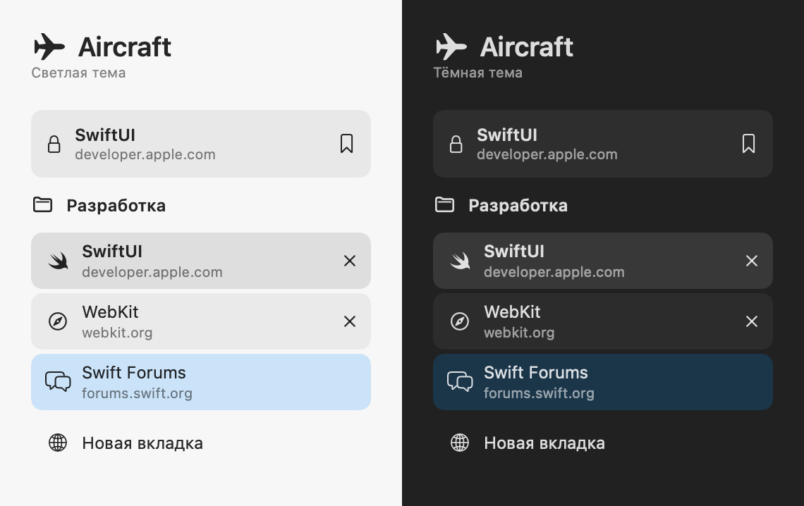

# Навигация Aircraft

В Aircraft человек часто ищет нужную страницу среди похожих вкладок. Поэтому на первом плане стоит название, под ним — домен, а положение в дереве показывает вложенность. У открытой вкладки есть два признака: полужирное название и нейтральная подложка. Если человек выделит её вместе с другими через ⌘-клик, начертание по-прежнему укажет открытую страницу.

На образце SwiftUI открыта, на строку WebKit наведён указатель, Swift Forums включена в множественный выбор. Названия и адреса демонстрационные.

## Типографика и размеры

Размеры указаны в пунктах при масштабе вкладок 100%. Используйте системный шрифт macOS и SF Symbols. Для названий, адресов и значков вкладок учитывайте пользовательский tabScale.

| Элемент | Оформление |
| --- | --- |
| Название вкладки | 12 pt, Regular. Открытая вкладка — Semibold |
| Крупная строка в мобильной компоновке | 14 pt, открытая вкладка — Semibold |
| Папка и название в карточке адреса | Semibold, тот же размер, что у соседних названий |
| Домен и пояснение | 10 pt, системный вторичный цвет текста |
| Значок и название | Базовый интервал 8 pt, в крупной строке 12 pt |
| Дерево | У каждого уровня дополнительные 12 pt отступа слева |
| Скругления | Кнопка панели 6 pt, строка и поле адреса 8 pt, непрерывный контур |

## Состояния

Для нейтральных заливок используется системный цвет основного текста с прозрачностью. В светлой теме он затемняет фон, в тёмной — осветляет. Это позволяет применять одну шкалу поверх выбранного пользователем цвета окна.

| Состояние | Визуальный признак |
| --- | --- |
| Обычная вкладка | Прозрачная строка, название основным цветом |
| Указатель над строкой | Нейтральная подложка 6%, появляется кнопка закрытия |
| Текущая вкладка | Подложка 12% и Semibold. У компактного закрепа в верхней панели остаётся только подложка |
| Множественный выбор в дереве | Системный акцент с прозрачностью 18%, приоритет над нейтральной подложкой |
| Перетаскивание | Линия акцентного цвета перед вкладкой или заливка целевой папки |
| Поле адреса | Подложка 7%, при наведении на карточку в боковой панели — 10% |
| Пустая вкладка | Одна строка «Новая вкладка» |
| Выгруженная страница | В компактном дереве к домену добавляется «· выгружена» |

## Применение в SwiftUI

Общие роли объявлены в [BrowserDesign.swift](../Sources/EasyBrowser/BrowserDesign.swift). Для строки берите фон из Surface.tab, передавая отдельно признаки открытой вкладки, наведения и множественного выбора. Для заголовка используйте TypeRole.title, для домена — TypeRole.detail. В [TabTreeViews.swift](../Sources/EasyBrowser/TabTreeViews.swift) есть пример со всеми тремя состояниями.

Цвет рамки окна, материал Liquid Glass и скругление самой страницы задаёт [AircraftTheme](../Sources/EasyBrowser/Appearance.swift). Фавикон обозначает сайт, цвет папки задаёт пользователь. Вспомогательные состояния сопровождайте знаком или текстом: булавкой для закрепа, галочкой для скопированной ссылки, номером порта для локального сервера.
